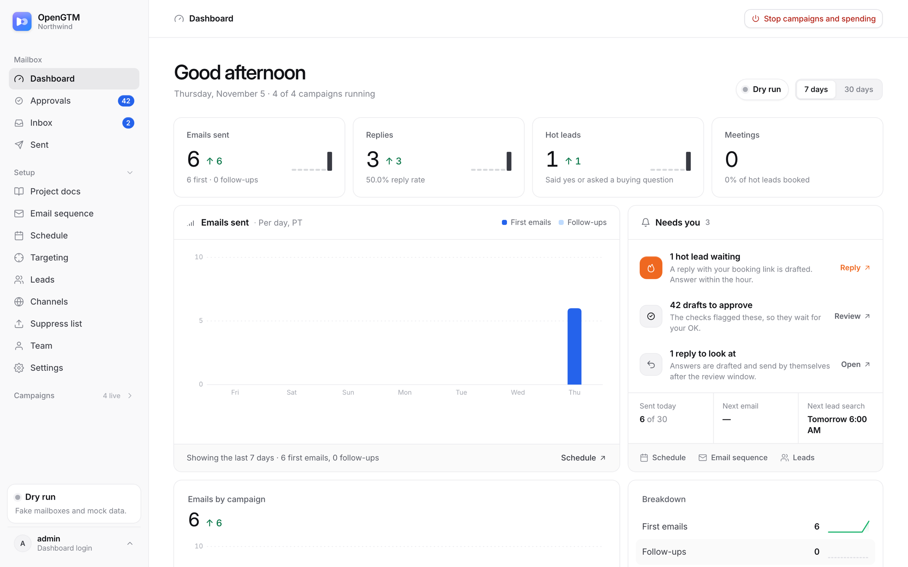
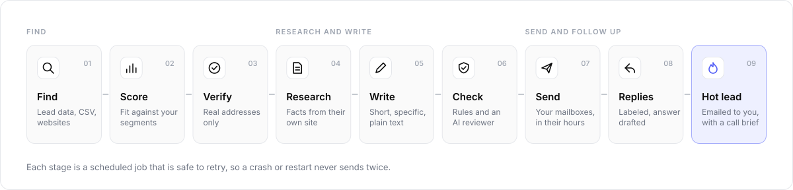
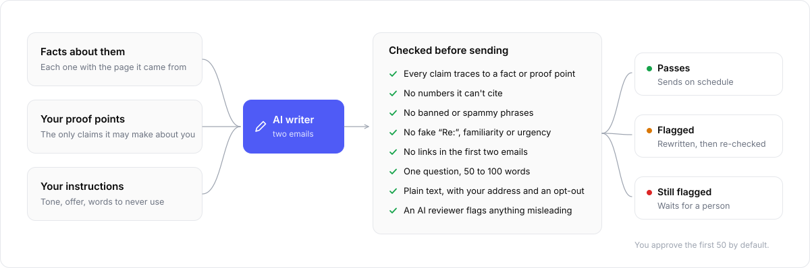
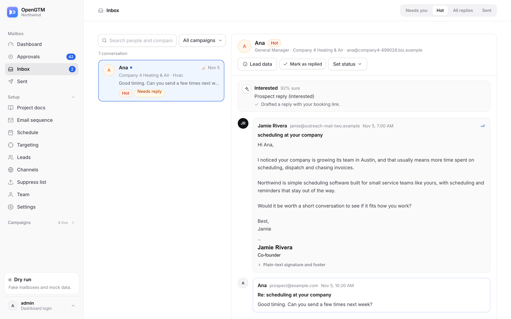
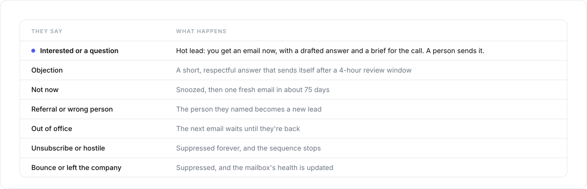
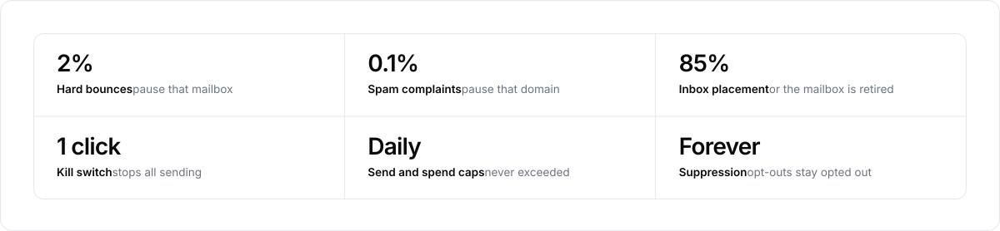
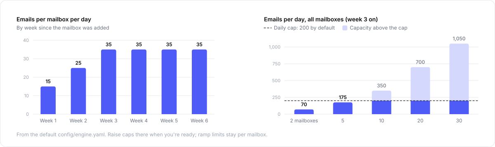
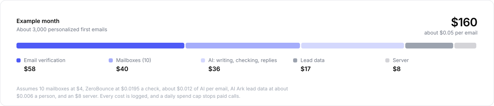
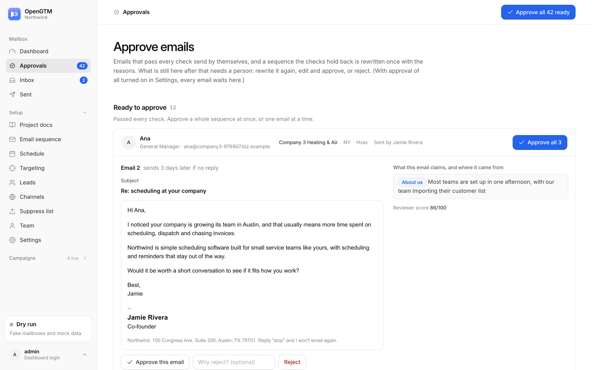

<p align="center">
  <picture>
    <source media="(prefers-color-scheme: dark)" srcset="docs/assets/logo-on-dark.svg">
    
  </picture>
</p>

<h3 align="center">Self-hosted AI outbound email</h3>

<p align="center">
  Finds companies that fit, researches each one, writes short honest emails,<br>
  sends them from your own mailboxes, and hands you the people who say yes.
</p>

<p align="center">
  <a href="LICENSE"></a>
  
  
  
</p>

<p align="center">
  <a href="https://deanayoung3-droid.github.io/opengtm/"><b>Website</b></a> ·
  <a href="#quickstart">Quickstart</a> ·
  <a href="docs/SETUP.md">Setup guide</a> ·
  <a href="docs/CONFIGURATION.md">Configuration</a> ·
  <a href="docs/DEPLOY.md">Deploy</a> ·
  <a href="docs/ARCHITECTURE.md">Architecture</a>
</p>

<br>

<picture>
  <source media="(prefers-color-scheme: dark)" srcset="docs/assets/screenshots/dash-dark.png">
  
</picture>

<br>

OpenGTM runs the whole outbound loop for a small team: lead search, research, writing, sending, reply
handling and follow-up. You run it on your own server. Your leads, emails and replies stay in your own
database, and you pay only for what you use. No seats, no platform fee.

## How it works

<picture>
  <source media="(prefers-color-scheme: dark)" srcset="docs/assets/pipeline-dark.svg">
  
</picture>

1. **Find.** Pulls companies and the people who decide from a lead database ([AI Ark](https://ai-ark.com)),
   your own CSV lists, or company websites. Buys only as many leads as your mailboxes can email in the next few days.
2. **Score and verify.** Rates every company 0 to 100 against the customers you describe, and verifies
   every address before it's used, so bounces don't burn your mailboxes.
3. **Research.** Reads each company's own website and stores facts with the page they came from.
4. **Write and check.** Drafts a short first email and a follow-up from those facts and your proof points
   only. A rule checker and an AI reviewer reject anything untrue, pushy or spammy.
5. **Send.** From your mailboxes (Google, Microsoft or any SMTP), in each recipient's business hours,
   ramping up slowly, one mailbox per conversation.
6. **Handle replies.** Labels every reply in context, stops the sequence, suppresses opt-outs, follows
   referrals, and drafts the answer. People who say yes become **hot leads**: you get an email right away
   and a one-page brief for the call.

## Honest by construction

<picture>
  <source media="(prefers-color-scheme: dark)" srcset="docs/assets/checks-dark.svg">
  
</picture>

Cold email works when it reads like a note from a person who did their homework. So the writer is boxed in:
it can only claim what a researched fact or one of your proof points says, it has to cite them, and a
deterministic checker blocks the rest before an AI reviewer even looks. You approve the first 50 emails
yourself; after that, emails that pass every check send on their own and anything flagged waits for you.

## Every reply, handled

<picture>
  <source media="(prefers-color-scheme: dark)" srcset="docs/assets/screenshots/inbox-dark.png">
  
</picture>

<picture>
  <source media="(prefers-color-scheme: dark)" srcset="docs/assets/replies-dark.svg">
  
</picture>

## Built not to burn your domains

<picture>
  <source media="(prefers-color-scheme: dark)" srcset="docs/assets/guardrails-dark.svg">
  
</picture>

<picture>
  <source media="(prefers-color-scheme: dark)" srcset="docs/assets/ramp-dark.svg">
  
</picture>

## What it costs

<picture>
  <source media="(prefers-color-scheme: dark)" srcset="docs/assets/cost-dark.svg">
  
</picture>

## Quickstart

You need [Docker](https://docs.docker.com/get-docker/) and [Node.js 22+](https://nodejs.org).

```bash
git clone https://github.com/deanayoung3-droid/opengtm.git && cd opengtm
node scripts/setup.mjs        # a few questions; writes .env and drafts your business profile from your website
docker compose up -d          # builds and starts the app
```

Open **http://localhost:8080** and sign in with the password the setup printed. The dashboard shows what's
still missing before anything can send: nothing goes out until you've added your postal address, a sender
and mailboxes.

Want to look around first? Set `GTM_DRY_RUN=1` in `.env` for fake mailboxes and sample data.

| | Guide |
|---|---|
| From zero to your first email: mailboxes, DNS, leads, verification | [docs/SETUP.md](docs/SETUP.md) |
| Your business profile, campaigns, AI models, limits | [docs/CONFIGURATION.md](docs/CONFIGURATION.md) |
| A server, HTTPS, backups, updates | [docs/DEPLOY.md](docs/DEPLOY.md) |
| Daily use, alerts and what to do about them | [docs/RUNBOOK.md](docs/RUNBOOK.md) |
| How it's built | [docs/ARCHITECTURE.md](docs/ARCHITECTURE.md) |

## Approvals

<picture>
  <source media="(prefers-color-scheme: dark)" srcset="docs/assets/screenshots/approvals-dark.png">
  
</picture>

Every draft shows its sources next to each claim. Approve, edit (edits are re-checked) or reject.

## What you need

| | | Typical cost |
|---|---|---|
| **Server** | Any machine with Docker and 1 GB of RAM | $0 to $12 a month |
| **AI** | An OpenAI or Anthropic key, or a local model with Ollama | about $0.01 per email, capped daily |
| **Mailboxes** | Inboxes on domains that aren't your main one; pre-warmed ones are fastest | about $3 to $5 each a month |
| **Verification** | [ZeroBounce](https://zerobounce.net) (100 free checks a month) | about $0.02 per address |
| **Leads** | AI Ark, or your own CSV lists | depends on the source |

## Responsible use

OpenGTM is built for honest, legal cold email in the US (CAN-SPAM). It won't send without your real postal
address, every email says who it's from and has a working unsubscribe, opt-outs are permanent, and fake
familiarity, fake urgency and fake "Re:" subjects are rejected. You're responsible for how you use it: only
email people you have a real reason to contact, use lead data whose terms allow outbound email, and keep
volume modest.

## Development

```bash
pnpm install
pnpm test        # ~180 tests, fully offline: in-memory Postgres, fake mailboxes, scripted AI answers
pnpm typecheck
```

TypeScript, Next.js, Postgres with Drizzle, and pg-boss for jobs. See [CONTRIBUTING.md](CONTRIBUTING.md) to
run the dashboard locally with demo data.

## License

[MIT](LICENSE)
